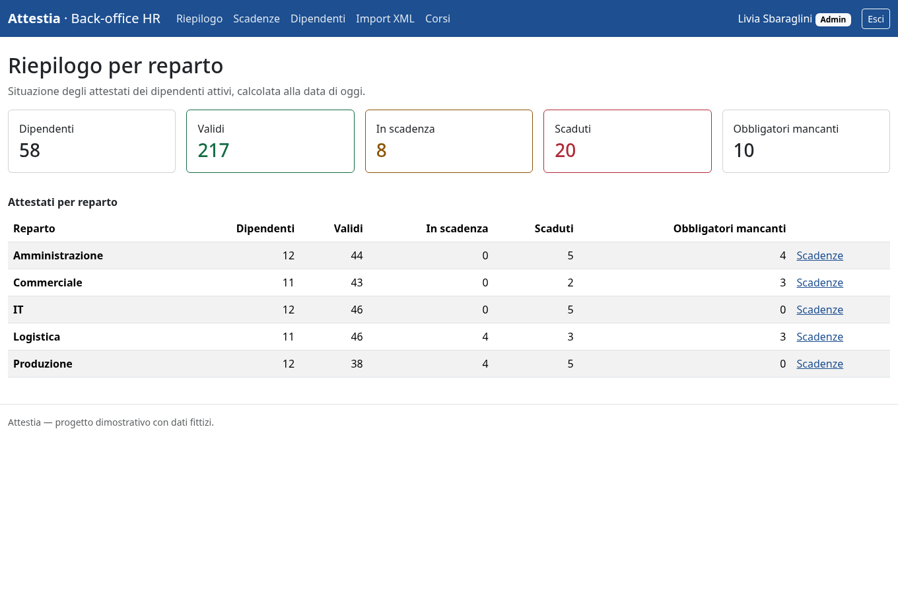
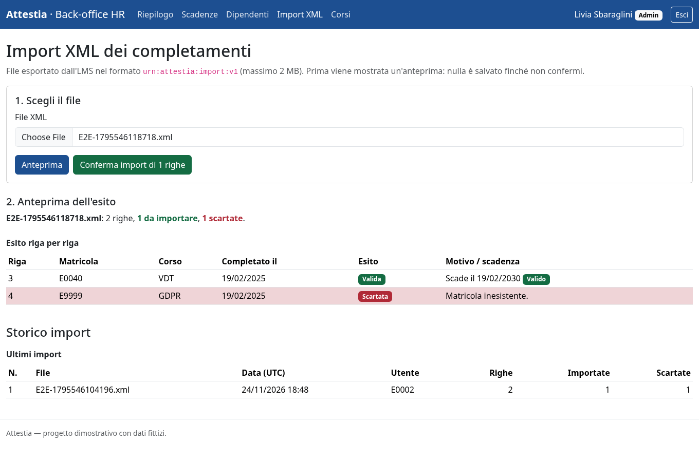
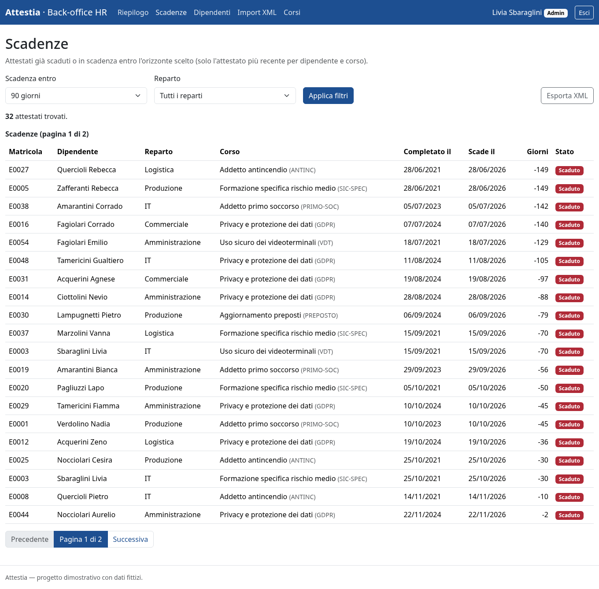
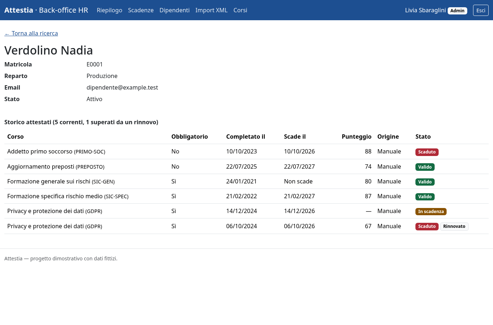
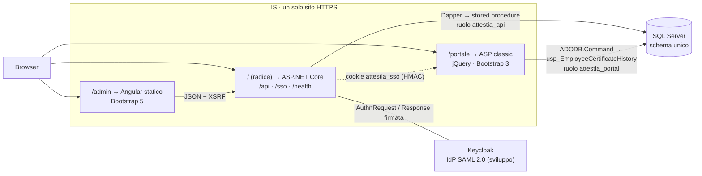
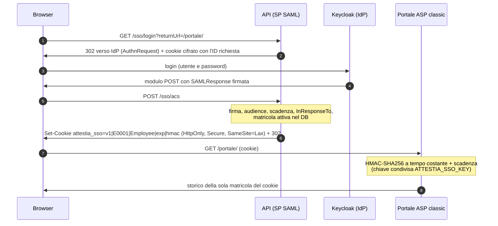

# Attestia

**Registro della formazione obbligatoria con scadenze.** Un'azienda registra i completamenti dei corsi (sicurezza sul lavoro, privacy, antincendio…), Attestia calcola la scadenza di ogni attestato, l'ufficio HR vede chi è scaduto o sta per scadere e ogni dipendente consulta il proprio storico. I completamenti possono arrivare anche da un file XML esportato da un LMS.

> **Progetto portfolio.** Non è in produzione e tutti i dati sono fittizi (nomi inventati, email `@example.test`). Le parti che girano solo su Windows (portale ASP classic e installazione IIS) sono **da verificare su Windows**: vedi la [tabella di verifica](#cosa-è-verificato).

| Back-office HR (Angular) | Import XML con anteprima riga per riga |
|---|---|
|  |  |
|  |  |

## Tecnologie e perché

| Tecnologia | Dove | Perché in questo progetto |
|---|---|---|
| **.NET 10 (C#), ASP.NET Core** | `src/Attestia.Api`, `Core`, `Data` | Web API JSON (minimal API), Service Provider SAML, regole di dominio |
| **MSSQL (SQL Server 2022)** | `db/` | Schema, tabella temporale, regole di stato in T-SQL, stored procedure, ruoli a privilegi minimi |
| **Dapper + stored procedure** | `src/Attestia.Data` | Il T-SQL è parte del progetto; il login applicativo ha solo `EXECUTE` |
| **Angular 22 + TypeScript** | `web/admin` | Back-office HR: standalone, signals, client tipizzato generato dall'OpenAPI |
| **Bootstrap 5** (SCSS) | `web/admin` | UI del back-office con colori adattati al contrasto WCAG AA |
| **ASP classic (VBScript)** | `legacy/portale` | Portale dipendenti "preesistente": legge lo storico via ADO e stored procedure |
| **jQuery + Bootstrap 3 + DataTables** | `legacy/portale/assets` | Arricchimento progressivo del portale legacy (file locali, niente CDN) |
| **JSON e XML** | API, portale, `contracts/` | JSON per API e portale (costruito a mano in VBScript); XML con XSD per import ed export |
| **SAML 2.0** | `/sso/*`, Keycloak | Login unico per back-office e portale (ITfoxtec come SP, Keycloak come IdP di sviluppo) |
| **IIS** | `deploy/iis` | Un sito con tre applicazioni (API, portale classic, Angular statico), script di installazione idempotente |
| **HTML5, CSS3, JavaScript** | ovunque | Markup semantico e accessibile, CSP senza script inline |

## Architettura



L'API è l'applicazione **radice** del sito: `/api` e `/sso` devono arrivare entrambi ad ASP.NET Core. `/portale` e `/admin` sono applicazioni figlie con il proprio application pool (vedi [DECISIONS.md](DECISIONS.md) D30).

### Una sola sessione per tre runtime



Lo stesso cookie è anche lo schema di autenticazione dell'API usato dal back-office Angular: un'unica scadenza, un unico logout. ASP classic non valida SAML (servirebbe una libreria XML-DSig affidabile in VBScript); le alternative valutate sono in [DECISIONS.md](DECISIONS.md) D23.

## Struttura del repository

```
src/Attestia.Api     Web API, Service Provider SAML, comandi CLI (migrate, sso-cookie)
src/Attestia.Core    dominio: regole di stato/scadenza, regole di import, parser XML sicuro, cookie SSO
src/Attestia.Data    Dapper + stored procedure, runner delle migrazioni (DbUp)
tests/Attestia.Tests xUnit v3: unit, integrazione su SQL Server reale (Testcontainers), API, SAML
web/admin            back-office Angular (Vitest, Playwright + axe)
legacy/portale       portale ASP classic · legacy/portale-tests: autotest HMAC per il collaudo
db/migrations        V001…V008 (T-SQL versionato) · db/seed: dati dimostrativi deterministici
contracts            XSD import/export, esempi XML validi e non validi, OpenAPI generato
deploy/docker        docker-compose (SQL Server 2022, Keycloak 26) + realm SAML
deploy/iis           Install-Attestia.ps1, web.config, build-package.sh, CHECKLIST.md
docs                 screenshot
```

## Avvio su Linux

Prerequisiti: Docker, **SDK .NET 10** (su Arch/CachyOS anche `aspnet-targeting-pack-10.0`), Node 24.

```bash
cp .env.example .env              # valori di SOLO sviluppo, palesemente finti
./dev.sh up                       # SQL Server 2022 + Keycloak, attende i controlli di salute
./dev.sh db                       # migrazioni + seed (un solo comando, idempotente)
(cd web/admin && npm ci && npm run build)
./dev.sh api                      # https://localhost:7180 (serve anche /admin)
```

Aprire <https://localhost:7180/admin/>. Utenti Keycloak di sviluppo (password `Dev-Only-Password-1`):

| Utente | Matricola | Ruolo | Può |
|---|---|---|---|
| `dipendente` | E0001 | Employee | solo il proprio storico (`/api/me/certificates`, portale) |
| `hr` | E0002 | HR | scadenze, riepiloghi, dipendenti, import/export XML |
| `admin` | E0003 | Admin | tutto ciò che fa HR + anagrafica corsi |

Console di Keycloak: <http://localhost:8081> (credenziali in `.env`). Il portale ASP classic non gira su Linux.

### Test

```bash
dotnet test                                                   # 209 test: unit + integrazione (serve Docker)
dotnet test -- --filter-not-trait "Category=Integration"      # solo unit test
(cd web/admin && npm test && npm run lint)                    # 25 test Vitest + ESLint (incluse regole a11y)
./dev.sh e2e                                                  # Playwright: login SAML reale, import, axe (stack avviato)
python3 scripts/check_portal.py                               # controlli statici del portale ASP classic
docker run --rm -v "$PWD:/w:ro" -w /w mcr.microsoft.com/dotnet/sdk:10.0 pwsh -NoProfile -File scripts/check_powershell.ps1
```

## Installazione su IIS

1. Su Linux: `deploy/iis/build-package.sh` produce `deploy/iis/out/{api,admin,portale}` (API pubblicata per `win-x64`, build Angular, portale, `web.config`).
2. Su Windows (PowerShell 5.1 come amministratore): `.\Install-Attestia.ps1 -PackagePath … -WhatIf`, poi senza `-WhatIf`. Lo script è idempotente: abilita le feature IIS (inclusa ASP classic), verifica Hosting Bundle .NET 10, URL Rewrite e MSOLEDBSQL, crea tre application pool con `ApplicationPoolIdentity` e ACL di sola lettura, imposta le variabili d'ambiente (chiave SSO letta come `SecureString`), certificato di sviluppo e binding HTTPS con SNI.
3. Migrazioni con un account proprietario: `dotnet Attestia.Api.dll migrate`; permessi SQL dei pool con `-ConfigureSqlLogins`.
4. Collaudo: [deploy/iis/CHECKLIST.md](deploy/iis/CHECKLIST.md) (21 passi con esito atteso).

## Cosa è verificato

| Area | Verificato in automatico (Linux) | Da verificare su Windows |
|---|---|---|
| Database | Schema, vincoli, tabella temporale, stored procedure, seed, permessi dei ruoli: test di integrazione su SQL Server 2022 reale | Login `IIS APPPOOL\…` associati ai ruoli (CHECKLIST 21) |
| Regole di stato | Stessi casi eseguiti su T-SQL e C# (test di parità) | — |
| API | Endpoint, validazione, ProblemDetails, autorizzazione per ruolo, CSRF, rate limit, intestazioni di sicurezza | Hosting in-process sotto IIS (ANCM), persistenza chiavi Data Protection |
| Import/export XML | XSD, anti-XXE, limiti, report per riga, idempotenza, concorrenza, export validato contro XSD; esempi verificati anche con `xmllint` | — |
| SAML / SSO | Test con IdP firmante in memoria (firma, audience, scadenza, InResponseTo, rotazione chiavi); login e logout con **Keycloak reale** (curl ed e2e) | Keycloak raggiunto dall'origine `attestia.local` (CHECKLIST 3, 7–8) |
| Back-office Angular | Test unitari, lint, build, e2e Playwright con login SAML reale e controlli axe WCAG 2.1 AA su 5 schermate | Deep link sotto IIS con URL Rewrite (CHECKLIST 15) |
| Portale ASP classic | Controlli statici: UTF-8/CRLF, `Option Explicit`, niente SQL concatenato, parametri e colonne coerenti con le procedure, output codificato, contratto del cookie | **Tutta l'esecuzione**: VBScript, ADO/MSOLEDBSQL, HMAC via COM (autotest col vettore, CHECKLIST 11), cookie alterati o scaduti, JSON (CHECKLIST 9–14) |
| IIS | `web.config` XML ben formati; `Install-Attestia.ps1` analizzato con il parser PowerShell e PSScriptAnalyzer (in Docker); pacchetto `win-x64` costruito | **Esecuzione dello script**, pool, ACL, rewrite, intestazioni, limiti di upload, file riservati (CHECKLIST 4–6, 17–20) |
| CI | GitHub Actions **verde** su GitHub: build e test .NET, Angular, e2e con Keycloak, controlli statici, gitleaks, CodeQL (nessun risultato) | — |

## Scelte tecniche principali

Tutte motivate, con alternative scartate, in [DECISIONS.md](DECISIONS.md). In breve:

- **Logica di stato scritta una volta in T-SQL** (`fn_CertificateStatus`, inline TVF) e replicata in C#, con un test di parità sugli stessi casi.
- **`ExpiresOn` colonna calcolata persistita** su una copia della validità del corso al momento del completamento: cambiare un corso non riscrive gli attestati storici.
- **Import idempotente su tre livelli**: SHA-256 del file, righe già presenti scartate con motivo, vincolo unique; righe valide e log in un'unica transazione con TVP, con nuovo tentativo in caso di conflitto concorrente.
- **Parsing XML sicuro**: niente DTD né resolver, limiti di dimensione e profondità, schema scelto dal server.
- **Una sessione, tre runtime**: cookie HMAC condiviso tra API, Angular e ASP classic, scritto senza URL-encoding.
- **Privilegi minimi ovunque**: ruoli SQL con solo `EXECUTE` (il portale su una sola procedura), un application pool per applicazione, ACL di sola lettura.

## Sicurezza in sintesi

HTTPS e HSTS; cookie `HttpOnly`/`Secure`/`SameSite=Lax`; CSRF con token antiforgery su ogni scrittura; solo query parametrizzate (stored procedure, `ADODB.Command`); output codificato (`HTMLEncode`, JSON escapato, `.text()` in jQuery); CSP senza script inline; nessuna eccezione interna nelle risposte; nessun dato sensibile nei log (mai cookie, asserzioni o contenuto dei file); segreti solo in variabili d'ambiente (`.env` è ignorato da git). In CI: CodeQL, ricerca di segreti, audit delle dipendenze NuGet e npm.

## Limiti noti

- **Portale ASP classic e installazione IIS non eseguiti**: scritti con cura e controllati staticamente, ma da collaudare su Windows (checklist).
- Le **AuthnRequest non sono firmate** (scelta di sviluppo, vedi D24); in produzione si può configurare un certificato SP.
- Keycloak di sviluppo in HTTP e con utenti dimostrativi: solo per l'uso locale.
- Dopo una **rotazione delle chiavi dell'IdP** i login possono fallire per al massimo un minuto (D28).
- **Bootstrap 3** nel portale è fuori supporto: è una scelta voluta per rappresentare un sistema preesistente, in produzione andrebbe migrato.
- Axe rileva solo una parte dei criteri WCAG: ordine del focus, testi e screen reader vanno provati a mano.
- Nessuna gestione anagrafica dei dipendenti (arrivano dal seed): fuori dal perimetro richiesto.
